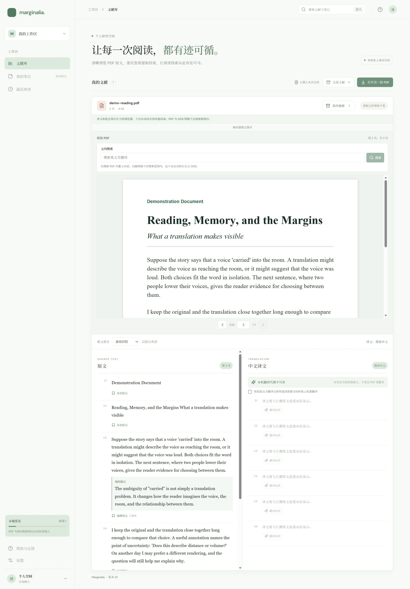
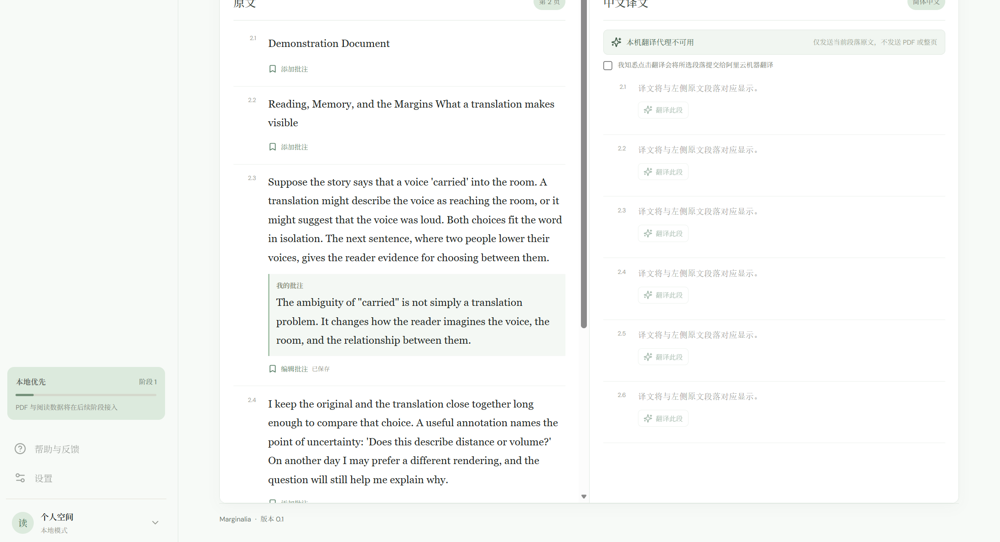
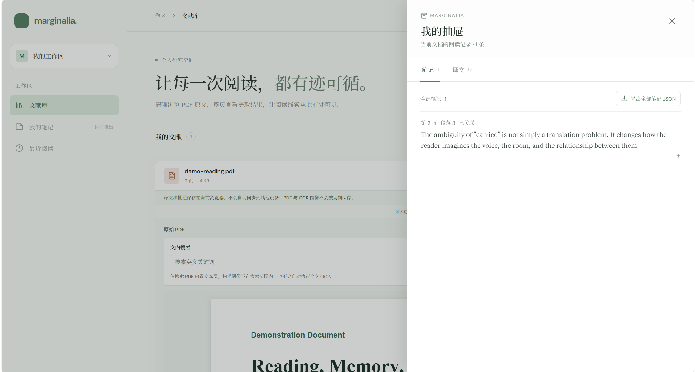

# Marginalia（页边）

Marginalia 是面向中文学术读者的本地优先 PDF 阅读器。它把查找原文、按需翻译和段落批注放在同一个阅读界面中，适合需要精读外文论文的学生、研究者和独立学习者。

## 产品定位

读外文论文时，复制段落到翻译工具、切回 PDF 核对上下文、再把批注记到其他应用，会打断阅读，也让笔记难以追溯到原文。V1 聚焦单篇文献的精读流程：导入 PDF → 找到原文 → 按需翻译或批注 → 下次重新打开时继续阅读。

## V1 已实现

| 功能 | 当前支持范围 |
| --- | --- |
| PDF 阅读与定位 | 导入本地 PDF，浏览页面，提取内置文本层并按段展示，从段落定位回 PDF 页面。 |
| 文内搜索 | 在当前 PDF 的内置文本层中查找关键词，按页展示匹配并跳转。搜索可取消，已扫描结果会保留。 |
| 日语扫描页 OCR | 页面无可提取文本时，尝试在浏览器里识别日语横排和竖排文字。首次加载需要从 CDN 下载运行时和模型。 |
| 按需翻译 | 经读者确认后，可翻译段落或选中文本。支持英语、日语、法语、德语作为源语言，目标为简体中文。自动识别使用轻量规则，识别不确定时可手动选择。 |
| 批注与归档 | 编辑和删除段落批注，在归档中查看已保存的批注与段落译文，并分别导出 JSON。 |
| 继续阅读 | 在同一个浏览器和站点地址重新打开同一份 PDF 时，恢复阅读位置以及该文档的已保存译文和批注。 |

## 关键产品设计决策

- **保留原文上下文。** 从提取出的段落回到 PDF 页面，方便读者核对排版、上下文和译文。OCR 用于缺少可提取文本的页面。
- **将翻译设为主动操作。** 用户确认后才发送待翻译文字，PDF 文件和 OCR 图像留在浏览器内。代理缓存译文，并限制请求长度、并发和每日用量。
- **以文档身份关联本地记录。** 阅读进度、译文和批注与 PDF 内容生成的文档标识关联。浏览器保存这些记录，读者可将译文与批注导出为 JSON。

## 技术栈与架构

| 层 | 实现 |
| --- | --- |
| 阅读界面 | React、TypeScript、Vite；PDF.js 在浏览器内渲染页面、读取文本层；Tesseract.js 在浏览器内执行 OCR。 |
| 浏览器存储 | IndexedDB 保存阅读进度、段落译文和批注；PDF 文件由读者从本地重新打开。 |
| 翻译链路 | 前端请求同源 `/api/translate`，Vite 将其转发到本机 Node.js 代理，代理调用阿里云机器翻译。 |
| 代理存储 | Node.js 的 SQLite 将译文缓存与额度记录保存在 `.local-data/translation-protection.sqlite`。API 凭据仅由代理读取。 |
| 工程验证 | pnpm 锁定依赖，Vitest 运行测试，TypeScript 与 Vite 执行构建。 |

## 本地运行

使用 Node.js 22.13+ 或 24+。候选版使用 pnpm 11.25.0 完成工程验收。

```sh
pnpm install --frozen-lockfile
pnpm dev
```

打开 Vite 输出的地址，默认是 `http://localhost:5173`。导入你有权使用的 PDF 即可体验阅读、搜索和批注。浏览器存储与站点地址绑定，后续阅读请使用同一地址。

### 启用阿里云机器翻译

在项目根目录把 `.env.example` 复制为 `.env.local`。填入已开通阿里云机器翻译服务的凭据，再在第二个终端启动代理。

| 环境变量 | 用途 |
| --- | --- |
| `ALIYUN_ACCESS_KEY_ID` | 阿里云 AccessKey ID。 |
| `ALIYUN_ACCESS_KEY_SECRET` | 阿里云 AccessKey Secret。 |
| `ALIYUN_MT_ENDPOINT` | 机器翻译服务 Endpoint。示例使用 `mt.cn-hangzhou.aliyuncs.com`。 |
| `TRANSLATION_PORT` | 可选，代理默认监听 `127.0.0.1:8788`。修改端口时需同步调整 `vite.config.ts` 中开发和预览的代理目标。 |

```sh
pnpm translation:server
```

回到阅读页，确认翻译服务就绪后即可使用。请将真实凭据保存在本机的 `.env.local` 中。按服务账户的实际计费规则使用翻译功能。

## 测试与构建

```sh
pnpm test
pnpm build
pnpm preview
```

`pnpm build` 生成 `dist/`。`pnpm preview` 在本机 `http://localhost:4173` 预览构建结果。使用翻译时仍需单独启动本机代理。

V1 候选版工程验收结果为 **175 passed、1 skipped、0 failed**。跳过的是实际 PDF 页眉回归测试，它通过 `MARGINALIA_HEADER_PDF_PATH` 读取外部真实 PDF 样本，该样本不随公开仓库提供。

仓库包含两份程序生成的合成 PDF 测试夹具，分别覆盖双页文本提取和纯图像页的无文本处理，便于公开、可复现地运行对应测试。

## 已知限制

- 搜索范围是当前 PDF 的内置文本层。扫描图像和 OCR 结果不进入文内搜索，也没有跨文献或跨批注的全局搜索。
- OCR 面向日语横排和竖排扫描页。识别受扫描质量与版式影响，首次加载依赖网络。
- 浏览器数据留在当前浏览器及站点地址下。清除站点数据会移除本地记录，重要批注和译文可以先导出。
- 翻译依赖本机代理、阿里云凭据和网络。使用前请确认待翻译文本适合发送给第三方。
- 当前为本地单用户运行方式。构建预览使用本地 Vite 服务。

## 后续规划

- 扩展 OCR 的语种和版式覆盖，探索扫描件全文索引。
- 探索跨文献与批注的检索，以及学术地图。
- 探索 AI 学术导读及出处核对。
- 评估经过用户授权的跨设备备份与同步。

## 产品截图

以下截图来自 V1 本地运行界面，使用[原创演示 PDF](screenshots/demo-reading.pdf)。

### PDF 阅读与段落化原文

原始 PDF 页面显示在上方，下方按段展示从文本层提取的英文原文。



### 段落级批注

已保存的批注显示在所属段落下方。截图中的翻译代理未启动，译文栏显示占位提示。



### 阅读记录归档

「我的抽屉」展示当前文档的已保存批注，并标明对应的页码和段落。


